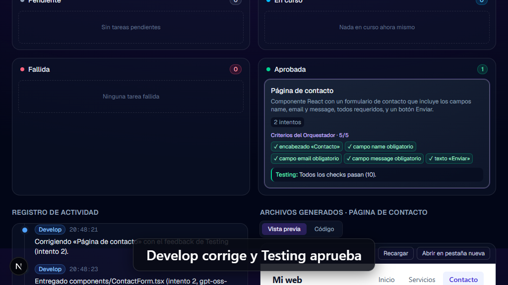
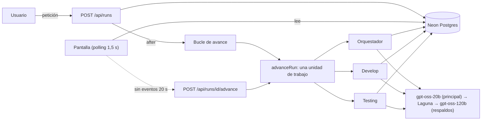

# Equipo de agentes de IA: Orquestador, Develop y Testing

[](https://github.com/Guille6520/agentes-equipo/actions/workflows/ci.yml)

Tres agentes de IA que colaboran sobre una petición escrita en lenguaje natural. El **Orquestador** la divide en tareas, **Develop** escribe el código de cada tarea y **Testing** lo comprueba de forma automática y devuelve lo que falla, hasta que todo pasa. En pantalla se ve en directo qué hace cada agente y en qué estado está cada tarea.

- **App desplegada:** https://agentes-equipo.vercel.app (requiere login; usuario y contraseña de prueba se facilitan por separado)
- **Repositorio:** https://github.com/Guille6520/agentes-equipo
- **Vídeo de demostración (75 s):** pulsa la imagen para verlo.

[](docs/video/demo.webm)

_Grabación automática de la app con rótulos (sin voz): login, petición con modo demo, bucle de corrección Testing → Develop con los criterios del Orquestador, vista previa interactiva, código generado y evaluación de modelos._

Hecho con Next.js, Neon (Postgres), Vercel AI SDK y modelos gratuitos. Programado con Claude Code (ver [Cómo usé Claude Code](#cómo-usé-claude-code)).

## Índice

1. [Qué hace exactamente](#qué-hace-exactamente)
2. [Qué peticiones admite](#qué-peticiones-admite)
3. [Cómo funciona](#cómo-funciona)
4. [El agente Testing](#el-agente-testing)
5. [Modelos de IA](#modelos-de-ia)
6. [Funciones extra: vista previa, modo demo y evaluación de modelos](#funciones-extra-vista-previa-modo-demo-y-evaluación-de-modelos)
7. [Stack y decisiones](#stack-y-decisiones)
8. [Ejecutar en local](#ejecutar-en-local)
9. [Despliegue](#despliegue)
10. [Seguridad](#seguridad)
11. [Limitaciones conocidas](#limitaciones-conocidas)
12. [Hoja de ruta](#hoja-de-ruta)
13. [Cómo usé Claude Code](#cómo-usé-claude-code)

## Qué hace exactamente

Escribes una petición como _«Añade una página de contacto a esta web»_ y ocurre esto:

1. **Orquestador** la divide en 1-4 tareas ordenadas por dependencia (por ejemplo: _formulario de contacto_ y _página que lo integra_) y **reparte el trabajo a los otros dos**: a Develop le asigna cada tarea y a Testing le define, por tarea, de 1 a 5 **criterios de aceptación verificables** (por ejemplo: encabezado «Contacto», campo email obligatorio, texto «Enviar»).
2. **Develop** toma cada tarea, con sus criterios, y genera archivos React/TypeScript (`components/ContactForm.tsx`, …), que guarda versionados.
3. **Testing** ejecuta comprobaciones automáticas sobre esos archivos y verifica los criterios del Orquestador. Si algo falla, redacta un feedback con el fallo, el archivo y la línea, y devuelve la tarea a Develop. Si todo pasa, la tarea queda aprobada.
4. El ciclo Develop ↔ Testing se repite hasta **3 intentos por tarea**. El run termina `passed` si todas las tareas pasan, o `failed` si alguna agota los intentos.

La pantalla muestra, con actualización cada ~1,5 s:

- una **tarjeta por agente** con su estado (activo o esperando) y su último mensaje;
- un **tablero** con las tareas en _Pendiente / En curso / Fallida / Aprobada_, con el número de intentos, el feedback de Testing y los criterios del Orquestador marcados como cumplidos o pendientes;
- un **registro de actividad** cronológico, con el agente, la hora y el mensaje;
- una **vista previa en vivo**: la página que han construido los agentes, montada dentro de una web de ejemplo («Mi web», con navegación y pie) y totalmente interactiva, en un iframe aislado;
- el **código generado** de cada tarea, con todas sus versiones.

**Qué es y qué no es.** El resultado son **componentes React generados, verificados y visibles en funcionamiento dentro de una web de ejemplo**. No modifica un repositorio ni una web real: no hay integración con Git ni despliegue automático de lo que genera. Es una demostración del patrón multiagente (reparto de trabajo, verificación y bucle de corrección), no un sustituto de un asistente de código sobre un proyecto existente.

## Qué peticiones admite

Funciona bien con **componentes de interfaz autocontenidos**: Develop solo puede importar `react` y los archivos que él mismo genera, y estiliza con clases de Tailwind.

Ejecuciones reales en producción con el modelo principal actual (`gpt-oss-20b`), 23/11/2026:

| Petición | Resultado |
|---|---|
| _Añade una página de contacto a esta web_ (sin modo demo) | 1 tarea con 5 criterios. En el primer intento faltaba el encabezado «Contacto» que había pedido el Orquestador; Testing lo devolvió y Develop lo corrigió en el segundo. 11 s |
| _Añade una página de contacto a esta web_, con modo demo | 1 tarea; Testing detectó el defecto forzado, Develop lo corrigió en el segundo intento y se cumplieron 5/5 criterios. 12 s |
| _Crea una sección de preguntas frecuentes…_, con modo demo | 1 tarea, corregida en el segundo intento. 6 s |

Antes, con los repartos anteriores (primero Gemini y Laguna, después solo Laguna como principal), las mismas peticiones tardaban entre 33 y 96 s en producción. Con Laguna como principal también se probaron, desde el script de extremo a extremo: una FAQ con acordeón accesible (2 tareas, un fallo de render corregido en el segundo intento, 55 s), un formulario de newsletter con solo el email (1 tarea, 15 s) y un logotipo en SVG (1 tarea, 17 s).

Otros ejemplos razonables: una tabla de precios con tres planes (medida en el benchmark de prompts), un formulario de registro o de login, una tarjeta de producto con precio y botón, o una lista de tareas con estado local.

Cada resultado es **una sola ejecución**: indica lo que ocurrió, no una media.

**Lo que no admite** (por diseño): vídeo, audio o imágenes raster, backend o API propios, acceso a base de datos, nada sobre el servidor (variables de entorno, claves, archivos, procesos), librerías externas, `next/link` o rutas de Next, archivos CSS, y tareas que no sean un componente renderizable (tests, despliegue, configuración). Sí admite dibujos, iconos y logotipos en SVG, porque son código dentro del componente (probado: _«Crea un logotipo en SVG de una taza de café»_ pasó a la primera). Las imágenes externas no se cargan en la vista previa, que solo permite imágenes incrustadas.

**Cortafuegos de alcance.** Si la petición está claramente fuera de lo que sabe hacer, el Orquestador no inventa tareas: responde que está fuera de alcance y el run se cierra en ese momento con el motivo y ejemplos de lo que sí se puede pedir, sin reintentos ni llamadas a Develop. Probado con _«Hazme un vídeo de un gato bailando»_: antes daba 3 reintentos y un error confuso en 30 s; ahora, un mensaje claro en unos 3 s. En caso de duda, el Orquestador planifica en lugar de rechazar, para no bloquear peticiones válidas.

## Cómo funciona



### Estado en base de datos, no en memoria

Vercel ejecuta funciones efímeras, así que **todo el estado vive en Postgres** y cada paso es idempotente:

- `runs`: la petición y su estado (`running`, `passed`, `failed`).
- `tasks`: estado (`pending`, `running`, `failed`, `passed`), intentos, fase (`develop`/`testing`), perfil de checks, criterios de aceptación del Orquestador (con el resultado de la última revisión) y último feedback.
- `files`: archivos generados, con versión igual al número de intento.
- `events`: el registro que muestra la pantalla.

### Una unidad de trabajo por llamada

`advanceRun(runId)` hace **una sola cosa** y devuelve si queda trabajo: planificar, generar o corregir una tarea, revisarla, o cerrar el run. Las escrituras de cada paso son atómicas (`db.batch`), así que un paso que muere a medias se repite sin duplicar nada.

### Bloqueo (lease) para que no corran dos avances a la vez

Antes de avanzar, el motor toma un _lease_ en la base de datos con un `UPDATE` atómico sobre `locked_until` y `lock_token`. Dura 60 s y se renueva cada 20 s mientras el paso trabaja; si la función muere, caduca y otro avance retoma el run. Se comprueba justo antes de cada escritura, aunque no es una exclusión perfecta: queda una ventana de carrera mínima.

### Dos disparadores, un mismo motor

1. Al crear el run, `POST /api/runs` lanza un bucle con `after()` (hasta 300 s; solo empieza pasos nuevos durante los primeros 200 s).
2. Si la pantalla ve un run en curso que lleva 20 s sin eventos, llama a `POST /api/runs/[id]/advance`. Sirve para recuperar un bucle cortado o un run abierto tras recargar.

Ambos pasan por la misma función y el mismo lease.

### Fallos de modelo

Cada llamada tiene timeout (30 s Orquestador y Testing, 45 s Develop), un reintento con espera y, si sigue fallando, una **cadena de respaldos**: Laguna (NVIDIA, otro proveedor) y después `gpt-oss-120b` (Groq), con un intento cada uno. Cada salto queda registrado como evento visible («X falla; uso Y como respaldo»), y un proveedor sin clave configurada se salta sin parar la cadena. Si fallan todos los modelos 3 pasos seguidos, el run se detiene.

## El agente Testing

**El veredicto lo dan comprobaciones deterministas, no un LLM.** El modelo solo redacta el mensaje de corrección a partir de los fallos. Así el mismo código da siempre el mismo resultado, y un modelo no puede aprobar por error código defectuoso.

| Check | Qué comprueba |
|---|---|
| Sintaxis y tipos | Compila en memoria con la API de `typescript` (`strict`, `jsx: react-jsx`); informa de archivo y línea |
| Accesibilidad | Recorre el AST: label asociado a cada campo, botones con texto, `alt` en imágenes, `aria-*` válidos, sin `tabIndex` positivo |
| Formulario | `onSubmit`, validación de cada campo, `type="email"` en emails y región `role="alert"`/`status` |
| Seguridad | Sin `dangerouslySetInnerHTML`, `eval`, `new Function`, claves con patrón conocido ni `fetch` a dominios externos. Recorre el AST y bloquea las primitivas para escapar del sandbox: `.constructor`, `__proto__`, `process`, `globalThis`, `Function`, `Reflect`, `require`, `import()` dinámico, `with`… |
| Render aislado | Renderiza el componente con `react-dom/server` en un **proceso hijo sin variables de entorno y con el modelo de permisos de Node** (timeout 2 s) y comprueba que no lanza y produce HTML |
| Criterios del Orquestador | Verifica sobre ese HTML los criterios de la tarea: texto visible, elementos (con mínimo), campos (y si son obligatorios), encabezados y enlaces |

Los criterios usan un **vocabulario cerrado** (`text`, `element`, `field`, `heading`, `link`) validado con zod: el Orquestador no puede pedir algo que Testing no sepa comprobar, y los criterios inválidos se descartan sin tumbar el plan. Si el render no se ejecuta (por un error de sintaxis o de seguridad), los criterios quedan **omitidos**, nunca aprobados.

Hay tres perfiles según la tarea: **contact-form** (exige nombre, email y mensaje, solo para formularios de contacto), **form** (cualquier otro formulario: newsletter, registro, login…) y **basic** (sin formulario). Los checks estáticos de seguridad y sintaxis se ejecutan **antes**, y el render, que es el único paso que ejecuta código, solo corre si esos dos están limpios.

> **Sandbox del render.** El código se transpila en el servidor y se ejecuta en un proceso de Node aparte: `env: {}` (no hereda ninguna clave), modelo de permisos (solo puede leer React; no puede leer el resto del disco ni `/proc`, ni lanzar procesos o workers), sin `eval`/`Function` desde cadenas, con límite de memoria y con el proceso matado si no responde. Dentro, `node:vm` sigue cargando los módulos, pero ya no es la frontera: lo es el proceso. No es un contenedor ni una microVM (ver [Limitaciones](#limitaciones-conocidas)). Detalles en [`src/lib/testing/README.md`](src/lib/testing/README.md).

### Pruebas automáticas

- **19 casos de los checks de Testing** (componentes correctos y con un fallo plantado, incluidos un bucle infinito y criterios incumplidos): `npx tsx src/lib/testing/run-fixtures.ts`.
- **79 tests** con el runner nativo de Node para las piezas puras del motor: interpretación de las respuestas de los modelos, clasificación de errores, orden y saltos de la cadena de respaldo (con un modelo simulado), perfiles de checks, inyección del defecto del modo demo, límites de uso y la **regresión de seguridad del render** (la prueba de concepto de fuga de secretos, el aislamiento del proceso, los checks contra primitivas de escape y el tachado de secretos; el test de `/proc` solo se ejecuta en Linux): `npm test`.
- **Integración continua** en GitHub Actions en cada push y pull request a `main`: tipos, lint, tests y build en Linux, sin secretos ni llamadas a modelos.

## Modelos de IA

Los agentes usan **planes gratuitos**, como pedía el enunciado: `openai/gpt-oss-20b` (Groq) como modelo principal de los tres agentes y, como respaldos en este orden, `poolside/laguna-xs-2.1` (NVIDIA) y `openai/gpt-oss-120b` (Groq), con el Vercel AI SDK. `gemini-3.1-flash-lite` (Google) está fuera de la cadena mientras devuelva 503 y se sigue midiendo en `/evals`.

La elección salió de un benchmark y se corrigió con datos reales en producción:

1. Un benchmark de 8 modelos con la misma petición. Solo dos completaron las tres pruebas.
2. El reparto inicial era mixto (Gemini para Orquestador y Testing). Una vez desplegado, Gemini devolvió 503 de forma repetida y Laguna no falló nunca, así que se invirtieron los papeles y se acortaron los timeouts. Antes del cambio, un run con fallo forzado tardó 158 s, y un paso de ese run esperó 110 s por los 503; después, un run sin fallo forzado tardó 39 s con 0 respaldos. No son ejecuciones equivalentes (una incluía un intento extra de corrección), así que es una señal indicativa y no una comparación exacta.
3. Con Gemini dando 503, el respaldo no servía de nada en la práctica, así que se añadió Groq como tercer proveedor. Se midieron sus tres modelos de chat gratuitos con las mismas pruebas que `/evals`, dos veces cada una: `gpt-oss-20b` acertó 6 de 6 con 1,2 s de media, `gpt-oss-120b` 5 de 6 (un componente que no compilaba) y `qwen3.8-27b` 5 de 6 (límite 429 del plan gratuito). Se eligió `gpt-oss-20b`. Son muestras pequeñas: sirven para escoger un respaldo, no para clasificar modelos.
4. Por último se midieron los candidatos con **los prompts reales del motor** (3 repeticiones por prueba y un run completo con cada uno de principal). `gpt-oss-20b` fue el único sin fallos y el más rápido, así que pasó a principal (en producción, las ejecuciones completas pasaron de 33-96 s con los repartos anteriores a 6-16 s); Laguna quedó de primer respaldo por estar en otro proveedor, y `gpt-oss-120b` al final (en Develop compiló peor). Ese benchmark encontró además dos fallos de los prompts, ya corregidos (criterios SVG y nombres de campos). Detalle en [`docs/seguimiento-del-prompt.md`](docs/seguimiento-del-prompt.md).

Detalle completo, metodología, resultados y limitaciones: [`docs/seleccion-de-modelos.md`](docs/seleccion-de-modelos.md) y [`docs/model-comparison.md`](docs/model-comparison.md). El benchmark se reproduce con `node scripts/model-bench.mjs` y el de Groq con `npx tsx scripts/bench-groq.ts`.

## Funciones extra: vista previa, modo demo y evaluación de modelos

**Vista previa en vivo.** El panel de archivos tiene dos pestañas, _Vista previa_ y _Código_. La vista previa transpila en el servidor la última versión de los archivos de la tarea (por defecto, la última aprobada; si se muestra una que Testing aún no ha aprobado, lo indica), resuelve los imports entre ellos y monta el componente dentro de una web de ejemplo, con React cargado desde un CDN y Tailwind. Va en un `<iframe sandbox>` **sin** `allow-same-origin`, con una Content-Security-Policy que prohíbe cualquier conexión de red (`connect-src 'none'`). Así el código generado corre con un origen opaco: no puede leer las cookies de la app, ni su almacenamiento, ni llamar a ningún servidor. A diferencia de `node:vm`, esto sí es una frontera de seguridad real del navegador.

**Demo con fallo inicial.** Con buenos modelos casi todo pasa a la primera, así que el bucle de corrección apenas se ve. Una casilla junto a «Nueva petición» hace que Develop entregue, a propósito, una primera versión con un defecto real (un campo sin etiqueta). Testing lo detecta, devuelve el feedback y Develop lo corrige en el segundo intento. El defecto lo inserta el código de forma determinista, se registra como _«Modo demo… No es un error del modelo»_ y el run lleva una etiqueta «Demo».

**Evaluación de modelos (`/evals`).** Una página con la tabla del benchmark y un botón para **relanzar la evaluación de los tres finalistas** (Laguna, Gemini y `gpt-oss-20b`; Gemini hoy está fuera de la cadena) desde la app: 9 pasos (3 pruebas por modelo), uno por llamada para caber en los límites serverless, sin respaldo entre proveedores para medir cada modelo por separado. Hay un límite de una evaluación cada 10 minutos, comprobado en la base de datos, para proteger la cuota gratuita.

## Stack y decisiones

| Pieza | Elección | Por qué |
|---|---|---|
| Framework | Next.js (App Router), TypeScript, Tailwind | Requisito del enunciado |
| Base de datos | Neon (Postgres) + Drizzle ORM | Postgres real, plan gratuito que se reactiva solo; Supabase pausa el proyecto tras ~1 semana sin uso |
| IA | Vercel AI SDK, Groq + NVIDIA (Gemini solo en `/evals`) | Gratis y sin tarjeta; mismo código para todos los proveedores; permite la cadena de respaldo |
| Orquestación | Máquina de estados propia en base de datos | Control total, fácil de explicar y la pantalla pinta directamente lo guardado |
| Pantalla | Polling cada ~1,5 s | Más fiable en Vercel que el streaming, que choca con los timeouts serverless |
| Acceso | Login con cookie firmada (HMAC, `httpOnly`, 8 h) | Protege la cuota gratuita de IA y permite un usuario de prueba |

Alternativas descartadas y sus motivos en [`docs/seleccion-de-modelos.md`](docs/seleccion-de-modelos.md).

## Ejecutar en local

Requisitos: Node 22 (el render de Testing usa su modelo de permisos) y una base de datos Neon gratuita, más claves gratuitas de Groq, NVIDIA y Google (la de Google solo la usa `/evals`; si falta una clave, ese eslabón de la cadena se salta).

```bash
npm install
cp .env.example .env.local      # rellena las variables (ver abajo)
npx drizzle-kit push            # crea las tablas en Neon
npx tsx scripts/seed-demo.ts    # run de ejemplo (opcional)
npx tsx scripts/seed-evals.ts   # resultados del benchmark manual (opcional)
npm run dev
```

| Variable | Para qué |
|---|---|
| `DATABASE_URL` | Cadena de conexión de Neon (con pooling) |
| `GROQ_API_KEY` | API de Groq (principal `openai/gpt-oss-20b` y último respaldo `openai/gpt-oss-120b`) |
| `NVIDIA_API_KEY` | API de NVIDIA (primer respaldo, Laguna) |
| `GOOGLE_GENERATIVE_AI_API_KEY` | API de Gemini (solo `/evals`) |
| `DEMO_USER`, `DEMO_PASSWORD` | Usuario de prueba del login |
| `SESSION_SECRET` | Firma de la cookie de sesión |

**Nunca se suben claves al repositorio:** `.env.local` está ignorado y `.env.example` solo lleva marcadores.

Comprobaciones: `npm run typecheck`, `npm run lint`, `npm test` y `npm run build` (lo mismo que ejecuta la integración continua).

Scripts útiles: `npx tsx scripts/e2e-engine.ts "<petición>"` ejecuta el motor de principio a fin con los modelos reales (añade `--demo-failure` para el modo demo) y `npx tsx src/lib/testing/run-fixtures.ts` prueba los checks.

## Despliegue

Desplegado en **Vercel (plan Hobby)** con las variables de entorno configuradas en el proyecto. Dos detalles que importan:

- **Región `iad1` (Washington D.C.)**, la más cercana a la base de datos de Neon (AWS US East 2, Ohio): el motor hace muchas consultas por paso.
- **`next.config.ts` incluye en el bundle** las definiciones de TypeScript y de React que Testing necesita en tiempo de ejecución para compilar y renderizar, y el script del proceso hijo del render (`src/lib/testing/sandbox/render-child.cjs`). El trazado automático de Next no los detecta y, sin ellos, Testing suspendería todas las tareas en producción.

## Seguridad

- Ninguna clave en el repositorio; el historial se revisó con búsqueda de patrones antes de publicarlo.
- Login con cookie firmada, comparación de credenciales en tiempo constante, y límite de 5 intentos fallidos por IP en 10 minutos.
- Todas las rutas de la API están protegidas por la sesión.
- **Protección de la demo:** como máximo una ejecución en curso a la vez y 10 por hora, comprobado en la base de datos (respuestas 409 y 429 con mensaje claro), para que nadie agote la cuota gratuita de IA.
- La vista previa ejecuta el código generado en un iframe aislado (origen opaco y sin red), como se explica arriba.
- El código generado por los modelos se analiza de forma estática antes de ejecutarse y se renderiza en un proceso aislado sin variables de entorno ni permisos (ver abajo).
- Los textos que salen al exterior (eventos, feedback de Testing, errores de las APIs y de la vista previa) pasan por un filtro que tacha como «[oculto]» los valores de las variables de entorno sensibles y las claves con formato conocido (`nvapi-`, `gsk_`, `AIza`, `sk-`, credenciales de `postgres://`).

### Prompt injection

**Cómo se descubrió.** Escribí una prueba de concepto con una variable de entorno falsa: un componente con `(require as any).constructor("return process")()` escapaba del contexto de `node:vm` (que recibía objetos del servidor como `require` y React), leía `process.env` y sacaba el valor en el mensaje de una excepción. Ese mensaje llegaba al feedback de Testing y a los eventos visibles en pantalla, y ningún check estático lo detectaba. Con una petición maliciosa, Develop podría haber escrito ese código y filtrado las claves de los modelos, la URL de la base de datos o el secreto de sesión. La prueba de concepto está ahora en `tests/security.test.ts`.

**Modelo de amenazas.** La petición del usuario (y todo lo que se deriva de ella: tareas, código, feedback) es contenido no confiable que llega a los modelos. Lo que limita el daño:

- **Los agentes no tienen herramientas**: solo devuelven texto (un plan JSON, archivos de código o un feedback). No pueden leer archivos, llamar a APIs ni ejecutar nada por sí mismos.
- **El veredicto es determinista**: un texto persuasivo no aprueba una tarea; la aprueban los checks.
- **La vista previa corre en un iframe aislado** del navegador (origen opaco, sin red).
- **El render de Testing corre en un proceso aislado**: sin variables de entorno, sin poder leer el disco ni `/proc`, sin lanzar procesos y sin `eval`/`Function` desde cadenas. Si el código escapa de `vm`, no encuentra secretos que robar.
- **Checks estáticos contra primitivas de escape** (AST, no expresiones regulares): con cualquiera de ellas el render no se ejecuta.
- **Tachado de secretos** en todo lo que sale del servidor.
- **Prompts endurecidos**: la petición y el contenido van delimitados (`<peticion_usuario>…</peticion_usuario>`, sin que el usuario pueda cerrar la etiqueta), se declaran como datos y no como instrucciones, el Orquestador marca como fuera de alcance lo que toque servidor, variables de entorno, claves, archivos o ejecución fuera del componente, y Develop tiene prohibido `process`, `require`, `.constructor` y similares.

Ninguna capa es perfecta por sí sola (los prompts se pueden saltar y los checks estáticos se pueden esquivar); por eso son varias.

## Limitaciones conocidas

- **No integra el código en un proyecto real**: genera y valida componentes, pero no abre pull requests ni modifica un repositorio.
- **Testing comprueba estructura, no diseño**: no juzga si el resultado es bonito, correcto en contraste de color ni accesible con lector de pantalla; la accesibilidad es estática.
- **El sandbox de Testing es un proceso de Node, no un contenedor ni una microVM.** No tiene secretos ni permisos de disco o procesos, pero el modelo de permisos de Node 22 **no restringe la red**: un código que escapara de `vm` podría abrir conexiones (aunque ya no tendría secretos que enviar). Si la versión de Node no tuviera modelo de permisos, el hijo se ejecuta solo con el entorno vacío y deja un aviso en los registros y en el resultado del check. El de la vista previa sí es una frontera fuerte (iframe aislado del navegador).
- **La vista previa depende de dos CDN** (esm.sh y jsDelivr) para cargar React y Tailwind en el navegador; si no responden, muestra un error legible en lugar de la página.
- **Los criterios del Orquestador solo ven el estado inicial** del componente renderizado (no simulan clics ni envíos) y leen el HTML con expresiones regulares, suficiente para la salida de `renderToStaticMarkup`. Un criterio poco razonable puede hacer que una tarea agote sus 3 intentos.
- **Los límites de uso no son atómicos**: dos peticiones exactamente simultáneas podrían pasar las dos.
- **Dependencia de planes gratuitos**: pueden cambiar sus modelos, devolver 503 o saturarse; ya ocurrió con `gemini-2.5-flash` (retirado) y con `gemini-3.1-flash-lite` (503, hoy fuera de la cadena). El límite de tokens por minuto de Groq es ajustado para varios runs a la vez. Se mitiga con la cadena de respaldo (el primer respaldo está en otro proveedor) y los timeouts.
- **Muestras pequeñas** en el benchmark y en las ejecuciones de ejemplo (una por prueba), con heurísticas y sin revisión humana de la calidad.
- **Límite de intentos del login en memoria**: no se comparte entre instancias serverless.
- **Las pruebas automáticas cubren las piezas puras**, no el motor completo con base de datos: el flujo de extremo a extremo se prueba con un script que llama a los modelos reales, fuera de la integración continua.
- El comportamiento depende de los modelos, que no son deterministas: una misma petición puede tardar distinto o necesitar más intentos.

## Hoja de ruta

- **Evaluación de modelos continua y más rigurosa**: varias muestras por prueba y a distintas horas, revisión humana de la calidad, medición de coste y cuotas, y reevaluar modelos grandes (Kimi, GLM, Mistral) cuando haya menos congestión. Hoy esos modelos no se pudieron medir por timeouts.
- Sandbox de Testing con aislamiento de sistema operativo (contenedor o microVM, sin red), un paso más allá del proceso con permisos actual.
- Tests de comportamiento en Testing: simular el envío del formulario vacío y válido y comprobar los mensajes.
- Streaming en vivo del razonamiento de cada agente.
- Salida hacia un repositorio real (rama y pull request) con integración continua.
- Cola de tareas duradera para trabajos más largos.

## Cómo usé Claude Code

Programé el proyecto con **Claude Code** (desde su app de escritorio), no como autocompletado sino como compañero de trabajo con un método:

- **Decisiones guiadas.** Antes de cada paso importante, Claude me planteaba opciones con ventajas e inconvenientes y una recomendación ajustada al enunciado (base de datos, modelos, alcance del trabajo de los agentes, orquestación, interfaz, acceso). Yo decidía. Las decisiones y sus motivos quedaron escritos.
- **Memoria del proyecto.** El archivo [`CLAUDE.md`](CLAUDE.md) recoge el stack, las convenciones y los comandos, para que cada sesión empiece con el mismo contexto.
- **Configuración reutilizable.** En [`.claude/`](.claude) están el comando `/verify` (tipos, lint, tests, checks, build, comprobación del bundle de Vercel y búsqueda de secretos) y el subagente `code-reviewer`, que recoge los criterios con los que se revisó cada entrega.
- **Revisión crítica antes de entregar.** Con el proyecto ya funcionando, pedí a Claude Code que lo contrastara con el enunciado y señalara sus puntos débiles. De ahí salieron los criterios de aceptación (el Orquestador no repartía trabajo a Testing), la vista previa (el resultado no se veía como una página), la integración continua y los límites de uso.
- **Subagentes por dificultad.** Repartí el trabajo entre subagentes de Claude Code, con un modelo más potente para lo difícil (el motor de agentes) y modelos más ligeros para lo mecánico (login, pantalla, checks, benchmark). Los lancé **en paralelo sobre archivos distintos** para que no se pisaran.
- **Verificación independiente.** No acepté ninguna entrega sin comprobarla: ejecutaba `tsc`, `lint`, el build, las pruebas de los checks y ejecuciones reales con los modelos, y repasaba el código. Esa revisión encontró problemas reales que los propios subagentes no habían visto:
  - **Un fallo silencioso en Vercel:** sin incluir las librerías de TypeScript y React en el bundle, Testing habría suspendido todas las tareas en producción. El primer arreglo no cubría la ruta de Evals (el patrón con `[id]` no casaba) y lo detecté leyendo el trazado del build.
  - **Una decisión de modelos que no se sostenía:** tras desplegar, Gemini daba 503 repetidos; lo medí, invertí el reparto y documenté el cambio.
  - **Un Orquestador demasiado rígido:** exigía 2 tareas como mínimo y fallaba con peticiones pequeñas, aunque los dos modelos respondían bien con 1.
  - **Un perfil de checks mal aplicado:** un formulario de newsletter se evaluaba como formulario de contacto y obligaba a añadir campos que nadie había pedido. Se separó en un perfil genérico.
  - **Un cortafuegos de alcance demasiado estricto:** la primera versión rechazaba también un logotipo en SVG, que sí es un componente válido. Se ajustó el prompt y se probó con los dos casos.
  - **Un error falso en la vista previa:** las extensiones del navegador (MetaMask) inyectan scripts en el iframe y sus errores aparecían como si el código de los agentes hubiera fallado. El primer arreglo ocultaba también los errores reales; lo detecté probando los dos casos en el navegador antes de subirlo.
  - **La fuga de secretos del sandbox** (ver [Prompt injection](#prompt-injection)), descubierta con una prueba de concepto y cerrada con varias capas.
  - **Fallos que solo aparecían en la integración continua:** los tipos que Next genera en `.next/` no existían en un checkout limpio, y un test de seguridad de Linux partía de una suposición falsa sobre `/proc`. Los dos los detectó la CI antes de que llegaran a la entrega.
- **Seguridad en el proceso.** Las claves nunca pasaron por el chat ni por los commits; las introduje yo en `.env.local` y en Vercel. Cuando una orden tocaba credenciales y el sistema pidió confirmación, se respetó. Los commits incluyen la co-autoría de Claude Code.
- **Transparencia.** Las limitaciones y las mediciones se documentan tal cual, incluidas las que no salieron bien.
